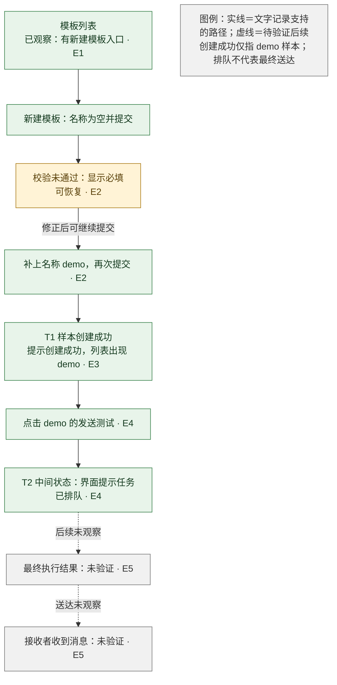

范围：虚构“通知模板”模块，编辑者角色，测试环境；版本、观察时间未知。以下仅整理用户提供的现场文字记录，未进行现场验证，无截图或事件文件。

证据索引（对原始文字记录编号）：

- E1：列表有“新建模板”入口。
- E2：名称为空提交显示“必填”；补上名称后可以继续提交。
- E3：保存提示“创建成功”，列表出现名为 `demo` 的模板。
- E4：点击 `demo` 的“发送测试”，界面提示“任务已排队”。
- E5：未观察到接收者收到消息或任务最终结果。

| 任务 | 前提与入口 | 操作及恢复路径 | 记录支持的结果 | 限制 |
|---|---|---|---|---|
| T1 创建通知模板 | 编辑者；模板列表的“新建模板”入口 | 空名称提交 → 提示“必填” → 补上名称 → 再次提交 | `demo` 样本创建成功，且在列表可见（E1–E3） | 仅覆盖该具体样本；空名称校验可恢复，不构成持续阻塞 |
| T2 发送测试通知并确认结果 | 列表中已有 `demo`；存在“发送测试”操作 | 点击“发送测试” → 查看反馈 | 界面显示“任务已排队”（E4） | 最终执行结果和接收者送达均未验证（E5）；不能据此判定发送成功或失败 |

已完成资料内两项任务及空名称失败恢复路径的整理。剩余证据缺口是测试任务的最终状态与接收者送达情况；现有记录不足以认定产品缺陷。